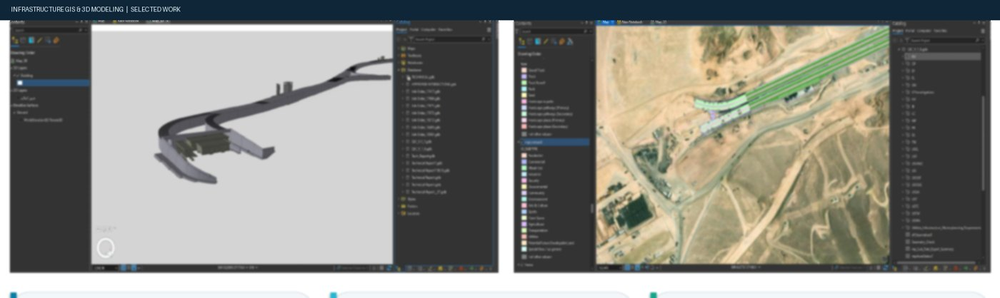
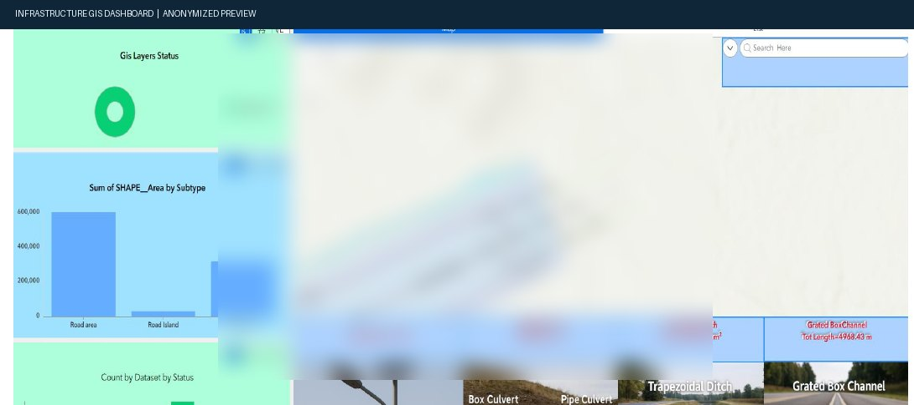
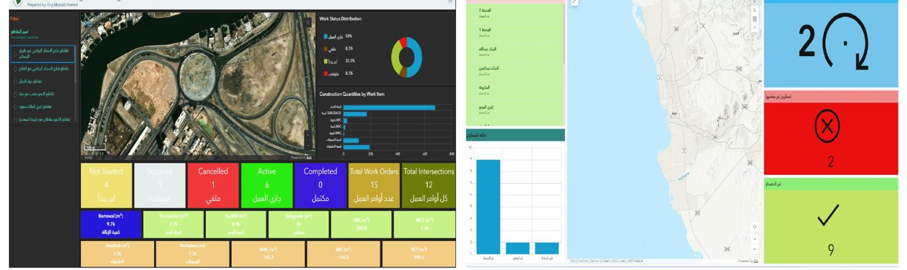
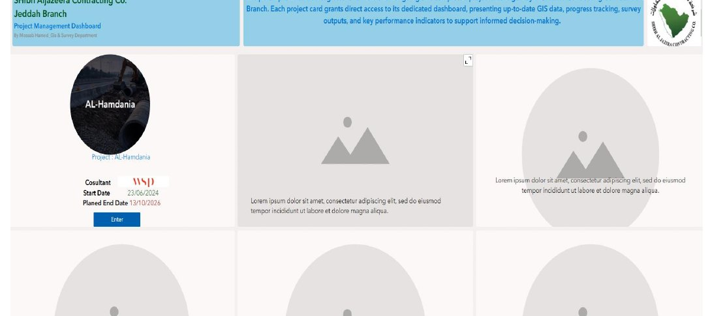
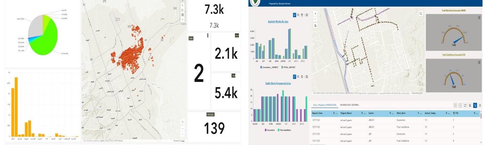

# Mossab Hamed

**GIS & Survey Engineer | Infrastructure GIS | Web GIS | 3D GIS & BIM–GIS**  
Riyadh / Jeddah, Saudi Arabia · 9+ years of professional experience

[LinkedIn](https://www.linkedin.com/in/mossab-hamed-67a527286/) · [Email](mailto:mos3bdasasa@gmail.com)

---

## Professional Summary

GIS and Survey Engineer experienced in geospatial data management and delivery for infrastructure, transportation, utilities, and construction. Focus areas include enterprise-ready geodatabases, spatial QA/QC, Web GIS applications, operational dashboards, 3D infrastructure visualization, and BIM–GIS workflows.

## Technical Capabilities

| Discipline | Tools / Methods |
|---|---|
| GIS & Web GIS | ArcGIS Pro, ArcGIS Online, ArcGIS Enterprise, Experience Builder, Dashboards, Survey123, StoryMaps |
| Geospatial data | Geodatabase design, domains, subtypes, schema management, metadata, spatial data governance |
| Automation & integration | Python, ArcPy, SQL, FME, ModelBuilder |
| Engineering | AutoCAD, Civil 3D, Revit, 3D GIS, BIM–GIS integration |
| Quality & handover | Geometry and attribute validation, topology, QA/QC checks, data completeness, digital handover |

## Selected Project Work

The examples below use selected screenshots from my project portfolio. Descriptions focus on the GIS workflows and outputs; client-specific details and sensitive project information are intentionally limited.

### 01 — Infrastructure GIS and 3D Modeling

Objective

Manage infrastructure geospatial data and support 3D visualization and coordination with engineering design information.

**Technical focus**
- Infrastructure feature data and structured geospatial information
- 3D infrastructure / tunnel visualization
- GIS coordination with engineering design data

**Relevant tools:** ArcGIS Pro · 3D GIS · Revit / Civil 3D workflows · Geodatabase design

> Client-specific live access is not published in this public portfolio.

### 02 — Construction Web GIS

**Technical focus**
- Construction GIS layers and project information
- Web-based access to spatial data and status information
- GIS reporting and data coordination

**Relevant tools:** ArcGIS Experience Builder · ArcGIS Online · Web GIS

> This preview has been sanitized. No live project link or confidential source data is published here.

### 03 — Operations Dashboards

**Technical focus**
- Site-work and permit monitoring
- Spatial context combined with status indicators and summary charts
- Operational reporting through interactive dashboards

**Live applications**
- [Site Works Dashboard](https://mos3.maps.arcgis.com/apps/dashboards/5f5fd31a7df24c26b86ad45b4f6d0d67)
- [Permits Dashboard](https://mos3.maps.arcgis.com/apps/dashboards/d7aca7c4fbea4603858c2eb55df4e3ba)

### 04 — Project Management Web GIS Portal

**Technical focus**
- Centralized navigation across project GIS resources
- Access to project dashboards and spatial outputs
- Project progress communication for stakeholders

**Live application:** [Open Project Management Portal](https://experience.arcgis.com/experience/3dfd999c6cb249239c8d30d887a16483)

### 05 — Utilities and Stormwater GIS

**Technical focus**
- Utility and stormwater asset visualization
- Spatial data organization and progress reporting
- GIS maps combined with charts and status indicators

**Live application:** [Open Al-Hamdania Stormwater Experience](https://experience.arcgis.com/experience/1e41a7c54fe3441cb24bdac547e0c160)

*An NWC Utility GIS live link was not included in the supplied portfolio, so it is not listed here.*

## Delivery Approach

1. **Structure the data** — define layers, fields, domains, subtypes, and metadata.
2. **Validate the content** — review geometry, attributes, topology, and data completeness.
3. **Publish for use** — configure web maps, applications, and dashboards for the intended audience.
4. **Prepare handover** — maintain traceability and provide consistent, reviewable GIS outputs.

## Contact

- **Email:** [mos3bdasasa@gmail.com](mailto:mos3bdasasa@gmail.com)
- **LinkedIn:** [Mossab Hamed](https://www.linkedin.com/in/mossab-hamed-67a527286/)
- **Location:** Saudi Arabia

---

*Public portfolio note: project previews are selective and sanitized where necessary. Access to confidential project environments and source data is not provided through this repository.*
