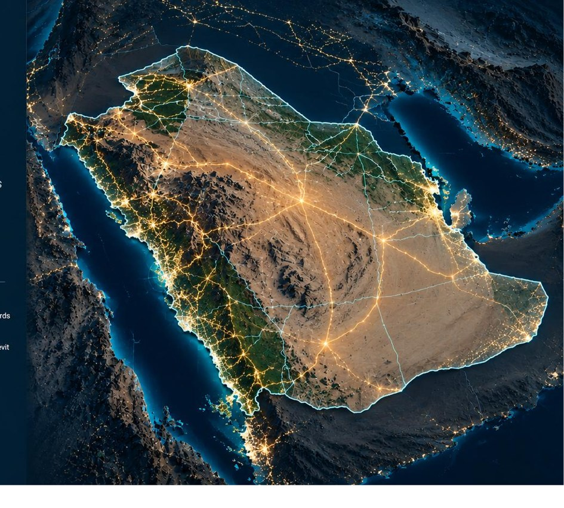

# Mossab Hamed
### GIS & Geospatial Engineer | Infrastructure GIS | Web GIS | 3D GIS & BIM-GIS

**Turning spatial data into real impact**

[LinkedIn](https://www.linkedin.com/in/mossab-hamed-67a527286/) · [Email](mailto:mos3bdasasa@gmail.com) · Riyadh / Jeddah, Saudi Arabia

---

## 👋 Professional Profile

GIS & Survey Engineer with **9+ years of professional experience** delivering geospatial solutions for infrastructure, transportation, utilities, and construction projects in Saudi Arabia. My work combines GIS data management, spatial QA/QC, web mapping, dashboards, and 3D/BIM-GIS workflows to support project delivery and reporting.

## 🗺️ GIS Expertise

- **Infrastructure & Transportation:** corridor mapping, construction datasets, and project reporting
- **Utilities:** water, wastewater, stormwater, and utility asset information
- **GIS Data Management:** geodatabase design, domains, subtypes, metadata, and data governance
- **QA/QC & Validation:** geometry checks, attribute validation, topology, and digital handover
- **Web GIS & Reporting:** ArcGIS Online applications, Experience Builder, and interactive dashboards
- **Digital Engineering:** 3D GIS, tunnel/infrastructure visualization, and BIM-GIS integration

## 🛠️ Technologies

| Area | Tools and methods |
|---|---|
| GIS & Web GIS | ArcGIS Pro, ArcGIS Online, ArcGIS Enterprise, Experience Builder, Dashboards, Survey123, StoryMaps |
| Data & Automation | Python, ArcPy, SQL, FME, ModelBuilder, geodatabase design |
| AEC / Engineering | AutoCAD, Civil 3D, Revit, BIM-GIS integration, 3D GIS |
| QA/QC & Delivery | Geometry validation, attribute QA/QC, topology, metadata, data governance |

## 🚀 Selected Projects

### 1. Infrastructure GIS & 3D Tunnel Modeling

**Focus:** 2D infrastructure GIS, structured geodatabase content, 3D infrastructure/tunnel visualization, and BIM-GIS coordination.

**Tools:** ArcGIS Pro · 3D GIS · Revit / Civil 3D workflows · Geodatabase design

> The image is a presentation preview. Project-specific live access and source data are not published here.

### 2. Qiddiya Al-Taif Road — Construction GIS

**Focus:** construction GIS, GIS layer status, infrastructure quantities, KPI reporting, and interactive web GIS.

**Tools:** ArcGIS Experience Builder · ArcGIS Online · Dashboards · GIS data management

**Live demo:** Not published in this public README because the project environment and data may be confidential. An anonymized preview is shown above.

### 3. Jeddah Traffic Congestion — Operational Dashboards

**Focus:** operational reporting for site works and permits, including work status, quantities, work orders, intersections, permit locations, and KPI summaries.

- [Open Site Works Dashboard](https://mos3.maps.arcgis.com/apps/dashboards/5f5fd31a7df24c26b86ad45b4f6d0d67)
- [Open Permits Dashboard](https://mos3.maps.arcgis.com/apps/dashboards/d7aca7c4fbea4603858c2eb55df4e3ba)

### 4. Jeddah Project Management Portal

**Focus:** multi-project navigation, access to project dashboards and GIS outputs, progress monitoring, and stakeholder reporting.

- [Open Project Management Portal](https://experience.arcgis.com/experience/3dfd999c6cb249239c8d30d887a16483)

### 5. Utilities & Stormwater GIS

**Focus:** utility and residential-connection mapping, spatial analysis, stormwater assets, progress indicators, charts, gauges, and reporting.

- [Open Al-Hamdania Stormwater Experience](https://experience.arcgis.com/experience/1e41a7c54fe3441cb24bdac547e0c160)
- **NWC Utility GIS:** dashboard preview included; a direct public link was not available in the supplied portfolio.

## 📌 Professional Highlights

- 9+ years of GIS and survey experience
- 15+ projects / workstreams represented in the portfolio
- Experience across infrastructure, transportation, utilities, and construction GIS
- Practical delivery across GIS databases, web applications, dashboards, QA/QC, and 3D GIS

## 📄 Full Portfolio

[View or download the PDF portfolio](assets/Mossab_Hamed_Portfolio.pdf)

## 🤝 Contact

- **Name:** Mossab Hamed
- **Role:** GIS & Survey Engineer
- **Location:** Riyadh / Jeddah, Saudi Arabia
- **Email:** [mos3bdasasa@gmail.com](mailto:mos3bdasasa@gmail.com)
- **LinkedIn:** [linkedin.com/in/mossab-hamed-67a527286](https://www.linkedin.com/in/mossab-hamed-67a527286/)
- **Phone:** +966 55 793 2973

---

*GIS · Infrastructure · Utilities · Web GIS · 3D GIS · BIM-GIS*

